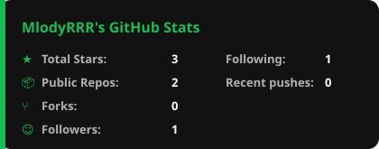

# MlodyR

GitHub profile · Code & music

 

### Contributions

<picture>
  <source media="(prefers-color-scheme: dark)" srcset="https://raw.githubusercontent.com/MlodyRRR/MlodyRRR/pacman-output/bomberman-contribution-graph-dark.svg?game=bomberman">
  <source media="(prefers-color-scheme: light)" srcset="https://raw.githubusercontent.com/MlodyRRR/MlodyRRR/pacman-output/bomberman-contribution-graph.svg?game=bomberman">
  
</picture>

 

### Stats & music

  
  

 

  

